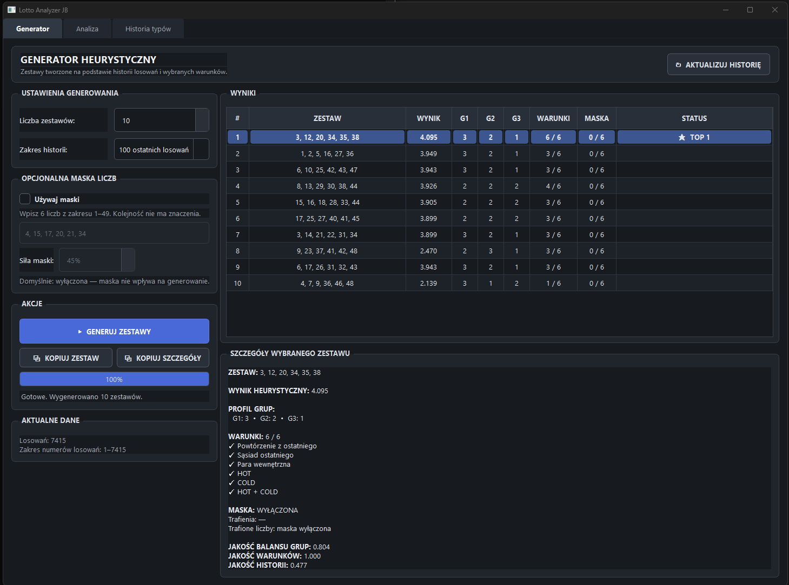
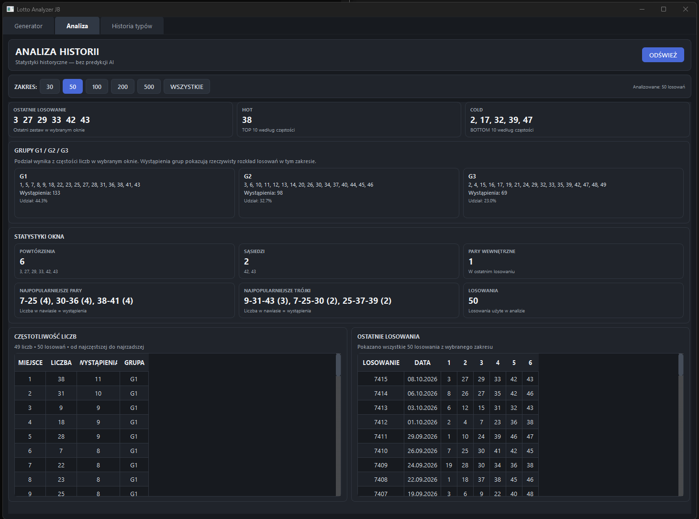
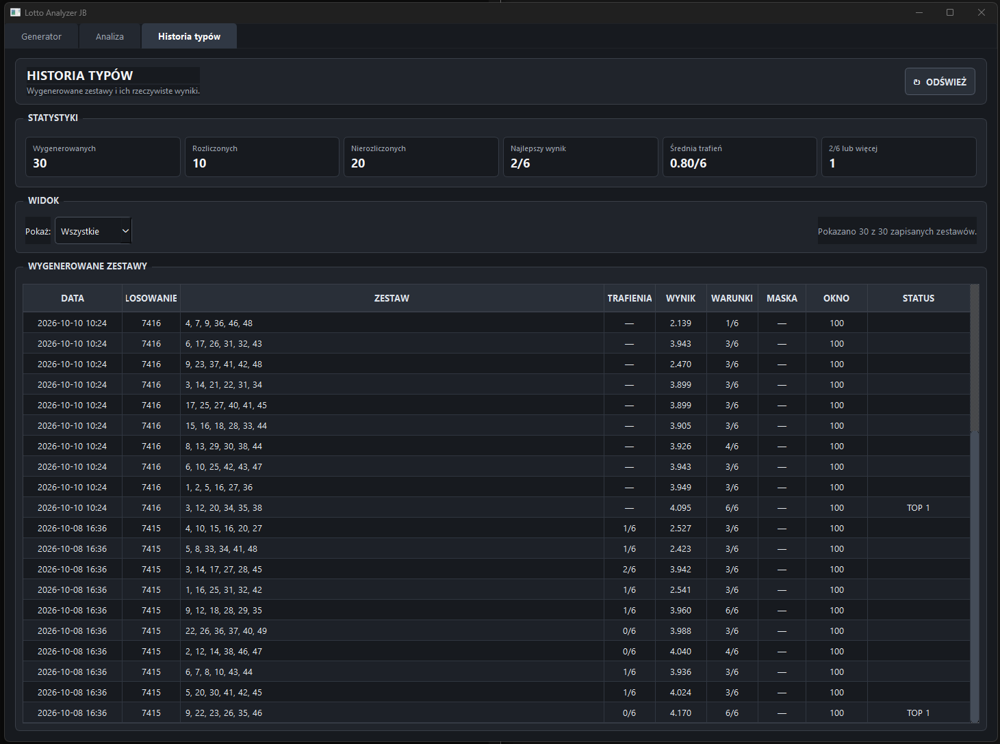

# Lotto Analyzer JB

**Desktop application for Lotto 6/49 analysis, heuristic combination generation, and historical backtesting.**

Built with **Python, PyQt6, pandas, and NumPy**.

Lotto Analyzer JB is a personal software engineering and statistical research project exploring how historical lottery data can be analyzed, visualized, and used to construct structured number combinations.

The application combines an interactive desktop interface with a configurable heuristic generator and reproducible historical evaluations.

> **Important:** This project does not claim to predict lottery results. In a fair Lotto 6/49 draw, every valid six-number combination has the same probability of winning the jackpot.

---

## Features

### Desktop application

- Graphical interface built with PyQt6.
- Historical Lotto 6/49 data analysis.
- Heuristic generation of number combinations.
- Examination of number groups and combination structures.
- Access to historical draw information.
- Historical data update functionality.
- Windows launcher for convenient startup.

### Research and backtesting

- Historical rolling-window evaluation.
- Generator comparison against a uniformly random baseline.
- TOP 1 and BEST TOP 10 performance metrics.
- Configurable history-window lengths and generator parameters.
- Analysis of number concentration and G1/G2/G3 combination profiles.
- Additional exploratory research scripts.

## Screenshots

### Combination Generator



### Historical Analysis



### Combination History



## Technology Stack

| Technology | Purpose |
|---|---|
| Python | Application and research logic |
| PyQt6 | Desktop graphical interface |
| pandas | Historical data processing |
| NumPy | Numerical operations |
| Git | Version control |

## Installation

### Requirements

- Windows
- Python 3.11 or a compatible version
- Internet access for optional data updates

### Clone the repository

```bash
git clone https://github.com/jarbart/lotto-analyzer-jb.git
cd lotto-analyzer-jb
```

### Create a virtual environment

```powershell
py -3.11 -m venv .venv
```

### Install dependencies

```powershell
.\.venv\Scripts\python.exe -m pip install -r requirements.txt
```

### Launch the application

```powershell
.\.venv\Scripts\python.exe app.py
```

Alternatively, on Windows, run:

```text
start_lotto_analyzer_jb.bat
```

The launcher expects a virtual environment in the `.venv` directory.

## Project Structure

```text
lotto-analyzer-jb/
├── app.py
├── analyzer.py
├── generator.py
├── loader.py
├── updater.py
├── backtest.py
├── requirements.txt
├── start_lotto_analyzer_jb.bat
├── data/
│   └── lotto.txt
├── tabs/
├── screenshots/
├── research/
│   ├── BACKTEST_100.md
│   ├── analyze_mask.py
│   ├── analyze_mask_extended.py
│   ├── analyze_mask_oos.py
│   ├── analyze_mask_permutation.py
│   └── results/
│       └── backtest_100.txt
└── README.md
```

## Historical Backtest

A historical evaluation was performed using a rolling **100-draw history window** over the latest **300 test draws**.

For each evaluated draw, the heuristic generator produced ten combinations, which were compared with ten uniformly random combinations.

### Experimental configuration

| Parameter | Value |
|---|---|
| Historical draws in dataset | 7,415 |
| Evaluated draws | 300 |
| History window | 100 |
| Combinations per draw | 10 |
| Generator candidate pool | 1,500 |
| Refinement | 50 |
| Generator seed | 42 |
| Random seed | 123556 |
| Optional mask | Disabled |

### Results

| Metric | Lotto Analyzer JB | Random |
|---|---:|---:|
| TOP 1 — average matches | 0.753 | 0.750 |
| TOP 1 — at least 2 matches | 13.3% | 16.7% |
| TOP 1 — at least 3 matches | 1.7% | 3.0% |
| BEST TOP 10 — average matches | **2.087** | 2.000 |
| BEST TOP 10 — at least 2 matches | **91.0%** | 83.7% |
| BEST TOP 10 — at least 3 matches | **16.3%** | 15.7% |
| BEST TOP 10 — at least 4 matches | **1.3%** | 0.7% |

### Interpretation

In this specific historical evaluation, the generator achieved a higher average BEST TOP 10 match count and a higher proportion of draws with at least two matches among the ten generated combinations.

The observed difference for BEST TOP 10 with at least two matches was **+7.3 percentage points** compared with the tested random baseline.

However:

- TOP 1 performance did not show a consistent advantage.
- The comparison used a single random baseline seed.
- The 100-draw history window was selected after exploring multiple window lengths.
- BEST TOP 10 represents the maximum match count among ten combinations after each draw, not the result of a single ticket.
- These results do not establish a statistically reliable predictive advantage.

See the [full backtest report](research/BACKTEST_100.md) and [complete experiment output](research/results/backtest_100.txt).

## Running the Backtest

To reproduce the published 100-draw-window evaluation without modifying `backtest.py`, run the following from the project root:

```powershell
@'
from pathlib import Path
import contextlib
import backtest

backtest.HISTORY_WINDOWS = [100]

output = Path("research/results/backtest_100.txt")
output.parent.mkdir(parents=True, exist_ok=True)

with output.open("w", encoding="utf-8") as file:
    with contextlib.redirect_stdout(file):
        backtest.main()

print("Backtest completed:", output)
'@ | .\.venv\Scripts\python.exe -
```

The evaluation may take some time to complete.

**Note:** The script's original console headings still use the project's former name, "LOTTO AI". The published application name is **Lotto Analyzer JB**.

## Research Notes

The `research/` directory contains exploratory scripts examining number masks, combination patterns, and out-of-sample behavior.

Exploratory results are treated separately from validated predictive claims.

The project is designed to demonstrate practical skills in:

- Python desktop application development.
- Data analysis and processing.
- Heuristic algorithm implementation.
- Experimental design and backtesting.
- Reproducible research documentation.

## Limitations

Lottery drawings are intended to be independent random events. Historical frequencies and patterns do not guarantee future outcomes.

The software is an educational and research tool, not a betting recommendation system.

## Author

GitHub: [@jarbart](https://github.com/jarbart)

## License

No open-source license has been selected yet. Until a license is added, standard copyright restrictions apply.